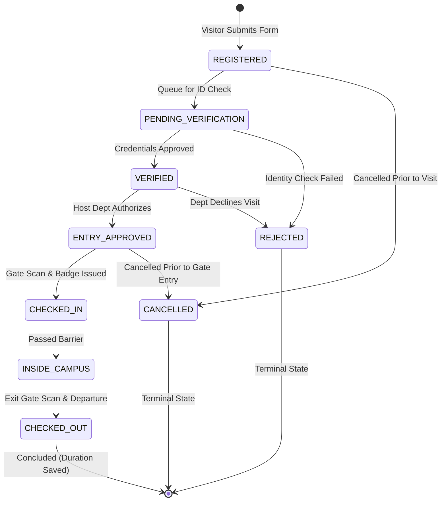

# Smart Campus Visitor Entry and Exit State Tracking System

[](https://reactjs.org/)
[]()
[]()
[]()

A full-stack enterprise web application built for college campus security management. The system tracks visitor movement through a **Deterministic Finite State Machine (FSM)**, enforcing security gates, verification steps, authorization passes, actual timestamps, and exit clearance while preventing illegal transitions and maintaining an auditable activity history.

---

## 1. Project Architecture & FSM Overview

The core mechanism of this application is a **Backend-Enforced Finite State Machine (FSM)**. Visitors cannot advance to subsequent states without satisfying exact pre-conditions.

### The 9 Visitor Lifecycle States

| # | State Name | Meaning / Description | Badge Color | Terminal? |
|---|------------|------------------------|-------------|-----------|
| 1 | `REGISTERED` | Visitor profile submitted online or at kiosk. | Blue | No |
| 2 | `PENDING_VERIFICATION` | Awaiting physical ID check by security personnel. | Yellow / Amber | No |
| 3 | `VERIFIED` | Govt ID / College ID verified by security personnel. | Indigo | No |
| 4 | `ENTRY_APPROVED` | Campus host / department granted entry pass. | Purple | No |
| 5 | `CHECKED_IN` | Visitor reached main gate; badge / RFID issued. | Teal | No |
| 6 | `INSIDE_CAMPUS` | Visitor passed physical barrier onto campus. | Emerald Green | No |
| 7 | `CHECKED_OUT` | Visitor scanned at exit gate; duration logged. | Slate / Gray | **Yes** |
| 8 | `REJECTED` | Entry denied by security or host department. | Red | **Yes** |
| 9 | `CANCELLED` | Visit cancelled prior to physical entry. | Rose | **Yes** |

### Permissible State Transitions Matrix



### Strict FSM Rules Enforced by Backend

1. **No Check-In Before Approval:** A visitor in `REGISTERED`, `PENDING_VERIFICATION`, or `VERIFIED` cannot check in directly. Attempting `REGISTERED -> CHECKED_IN` is blocked with an HTTP 400 illegal transition response.
2. **No Duplicate Check-In:** A visitor currently `INSIDE_CAMPUS` cannot be checked in again.
3. **No Checkout Without Prior Check-In:** Visitors cannot transition to `CHECKED_OUT` unless they are active and `INSIDE_CAMPUS`.
4. **Terminal State Immunity:** Visitors in `CHECKED_OUT`, `REJECTED`, or `CANCELLED` cannot re-enter or change states. A new registration is mandatory.
5. **Audited Violation Logging:** Every illegal transition attempt is permanently logged into `VisitorStateHistory` and `SecurityLog` with the operator's ID, timestamp, and violation reason.

---

## 2. Technology Stack

### Frontend
- **Framework:** React.js 18 (Vite SPA)
- **Styling:** Tailwind CSS with custom responsive design & animations
- **Routing:** React Router DOM v6
- **Icons:** Lucide React
- **Data Visualizations:** Recharts (Area charts, Bar charts, Pie charts, Line charts)
- **HTTP Client:** Axios with JWT request/response interceptors

### Backend
- **Runtime:** Node.js & Express.js (REST API architecture)
- **Database:** MongoDB with Mongoose ODM
- **Zero-Friction Fallback:** Built-in automatic fallback to `mongodb-memory-server` if local MongoDB is not yet started, ensuring 100% out-of-the-box local execution.
- **Security & Middleware:**
  - JWT (JSON Web Tokens) Authentication
  - Bcrypt password hashing
  - Role-Based Access Control (`ADMIN`, `SECURITY`, `VISITOR`)
  - Helmet security HTTP headers
  - CORS (Cross-Origin Resource Sharing)
  - API Rate Limiting (`express-rate-limit`)
  - Morgan request logging

---

## 3. Pre-configured Academic Test Credentials

The system includes pre-seeded demo accounts with convenient **1-click login buttons** on the login page:

| Role | Email | Password | Access Capabilities |
|------|-------|----------|---------------------|
| **ADMIN** | `admin@campus.edu` | `Admin@123` | Full dashboard analytics, user management, visitor deletion, security audits. |
| **SECURITY GUARD** | `security@campus.edu` | `Security@123` | Gate scanner, check-in, check-out, ID verification, FSM transition engine. |
| **VISITOR** | `visitor@campus.edu` | `Visitor@123` | Self-service registration, pass lookup, visit details tracking. |

*Note: In the dashboard top navigation bar, you can also switch roles on-the-fly via the quick role switcher pill to demonstrate role-based access control.*

---

## 4. Local Development Setup (Visual Studio Code)

### Prerequisites
- Node.js (v18.0.0 or higher recommended; tested on v26.7.0)
- Visual Studio Code

### Step 1: Open Project in VS Code
Open the project directory in VS Code:
```bash
cd "C:\Users\ASUS HN262\.gemini\antigravity\scratch\smart-campus-visitor-system"
code .
```

### Step 2: Backend Setup
Open a terminal in VS Code:
```bash
cd backend
npm install
npm run dev
```
- The backend will start on **`http://localhost:5000`**.
- It will automatically connect to MongoDB (or launch the in-memory database with pre-populated visitors and audit logs).
- API health check: `http://localhost:5000/api/health`.

### Step 3: Frontend Setup
Open a second terminal in VS Code:
```bash
cd frontend
npm install
npm run dev
```
- The Vite frontend will start on **`http://localhost:5173`**.
- Open your browser at `http://localhost:5173`.

---

## 5. System Modules & Features

### 1. Dashboard (`/dashboard`)
- 6 Statistics Cards: Total Today, Currently Inside, Checked Out, Pending Verification, Entry Approved, Rejected Visitors.
- Recharts 7-Day Footfall Trend, Department Distributions, Hourly Arrivals, and Visitor Composition.
- Live Table of visitors currently inside campus with direct Check-Out actions.
- Real-time audit log event stream.

### 2. Visitor Registration (`/register-visitor`)
- Full form validation for personal details, contact info, vehicle number, host, and purpose.
- Automatic unique Visitor ID generation (`SCV-YYYYMMDD-XXXX`).
- Duplicate registration prevention for active passes on the same day.
- Printable gate pass preview ticket.

### 3. Visitor Management (`/visitors`)
- Search by name, phone number, and pass ID.
- Dynamic filters: State (`ALL` or any of the 9 states), Department, and Date.
- Full details modal with pass barcode simulation and complete FSM audit trail.
- One-click **Export to CSV** button for administration reporting.

### 4. Identity Verification Queue (`/pending-verification`)
- Dedicated security workflow for incoming visitors in `REGISTERED` or `PENDING_VERIFICATION`.
- 1-click **Verify Identity** (advances state to `VERIFIED`) or **Reject Entry** (with mandatory reason).

### 5. Host Entry Approval Queue (`/entry-approval`)
- Department authority workflow for visitors in `VERIFIED` state.
- 1-click **Grant Entry Approval** (advances state to `ENTRY_APPROVED`, unlocking gate barrier).

### 6. Security Gate Check-In & Check-Out Terminal (`/check-in-out`)
- **Gate Check-In Tab:** Quick scanner by Visitor ID or Mobile number. Validates that state is `ENTRY_APPROVED`, records `actualEntryTime`, issues badge, and marks visitor `INSIDE_CAMPUS`.
- **Gate Check-Out Tab:** Displays all visitors currently `INSIDE_CAMPUS`, showing real-time elapsed minutes. 1-click **Check-Out** records `actualExitTime`, computes total duration, and marks visitor `CHECKED_OUT`.

### 7. Interactive FSM Transition Engine & Validator (`/fsm-engine`)
- **Visual State Selector:** Pick any visitor and test any target state.
- **Real-Time FSM Validator:** Immediately evaluates if the transition is **VALID** (Green) or **ILLEGAL** (Red), providing clear academic reasoning for the result.
- **Execute Transition:** Commits the transition to MongoDB.
- **Audit Table:** Filter between valid executions and recorded illegal attempts.
- **Quick Test Buttons:** Pre-loads academic test scenarios:
  - *Valid Check-In:* `ENTRY_APPROVED -> CHECKED_IN`
  - *Illegal Premature Check-In:* `REGISTERED -> CHECKED_IN`
  - *Illegal Re-Entry:* `CHECKED_OUT -> INSIDE_CAMPUS`

### 8. Visitor History & Timeline (`/visitor-history`)
- Chronological timeline for each visitor documenting their path through the state machine.

### 9. Activity Logs (`/activity-logs`)
- Filterable system log recording all registrations, checks, approvals, exits, and invalid attempts with user roles and timestamps.

### 10. Reports (`/reports`)
- Analytical department footfall breakdown, peak traffic pattern analysis, and printable summary.

### 11. User Management (`/user-management`)
- Administrator interface to add security guards, assign badge numbers, and toggle account status.

### 12. Visitor Self-Service Kiosk (`/portal`)
- Public guest portal allowing visitors to track their approval status online or submit their own pre-registration.

---

## 6. REST API Reference

### Authentication
- `POST /api/auth/register` - Create user account
- `POST /api/auth/login` - Authenticate & obtain JWT
- `GET /api/auth/profile` - Current user profile
- `PUT /api/auth/profile` - Update user profile

### Visitors
- `POST /api/visitors` - Register visitor
- `GET /api/visitors` - Filter & list visitors
- `GET /api/visitors/:id` - Visitor details + FSM history
- `PUT /api/visitors/:id` - Update visitor particulars
- `DELETE /api/visitors/:id` - Delete visitor (Admin only)
- `GET /api/visitors/search/:query` - Quick search by ID / phone

### FSM Transition Engine
- `GET /api/fsm/definition` - Complete FSM graph and states
- `POST /api/fsm/validate` - Simulate transition legality without execution
- `POST /api/fsm/transition` - Execute transition and record audit log
- `GET /api/fsm/history/:visitorId` - State history for specific visitor
- `GET /api/fsm/allowed-transitions/:visitorId` - Next legal states for visitor

### Security Checkpoints
- `PUT /api/visitors/:id/verify` - Advance to `VERIFIED`
- `PUT /api/visitors/:id/approve` - Advance to `ENTRY_APPROVED`
- `PUT /api/visitors/:id/reject` - Advance to `REJECTED`
- `POST /api/visitors/:id/checkin` - Advance to `CHECKED_IN` / `INSIDE_CAMPUS`
- `POST /api/visitors/:id/checkout` - Advance to `CHECKED_OUT`

### Dashboard & Logs
- `GET /api/dashboard/stats` - Summary KPI metrics
- `GET /api/dashboard/analytics` - Chart aggregations
- `GET /api/logs` - Security audit logs with filters

---

## 7. Project File Structure

```
smart-campus-visitor-system/
├── backend/
│   ├── config/
│   │   └── db.js                       # Mongoose connection & in-memory fallback
│   ├── controllers/
│   │   ├── authController.js           # Auth & profile logic
│   │   ├── dashboardController.js      # Analytics aggregations
│   │   ├── fsmController.js            # FSM execution & simulation
│   │   ├── logController.js            # Audit activity logs
│   │   ├── userController.js           # Security personnel management
│   │   └── visitorController.js        # Visitor CRUD & gate flows
│   ├── middleware/
│   │   ├── authMiddleware.js           # JWT verification & RBAC
│   │   └── errorMiddleware.js          # Central error handling
│   ├── models/
│   │   ├── SecurityLog.js              # Audit logs model
│   │   ├── User.js                     # User schema (Admin, Security, Visitor)
│   │   ├── Visitor.js                  # Visitor schema & 9 states
│   │   └── VisitorStateHistory.js      # FSM transition audit history
│   ├── routes/
│   │   ├── authRoutes.js
│   │   ├── dashboardRoutes.js
│   │   ├── fsmRoutes.js
│   │   ├── logRoutes.js
│   │   ├── userRoutes.js
│   │   └── visitorRoutes.js
│   ├── services/
│   │   ├── fsmService.js               # Finite State Machine core validation
│   │   └── seedService.js              # Demo database seeding
│   ├── utils/
│   │   ├── generateId.js               # Visitor ID generator (SCV-YYYYMMDD-XXXX)
│   │   └── jwt.js                      # Token signing utility
│   ├── .env.example
│   ├── package.json
│   ├── server.js                       # Express server entry point
│   └── test-fsm-api.js                 # Automated FSM test script
│
├── frontend/
│   ├── public/
│   ├── src/
│   │   ├── api/
│   │   │   └── axios.js                # Axios client with interceptors
│   │   ├── components/
│   │   │   ├── ConfirmationModal.jsx
│   │   │   ├── Navbar.jsx              # Header with role switcher
│   │   │   ├── Sidebar.jsx             # 12-item navigation menu
│   │   │   ├── StatCard.jsx            # KPI cards
│   │   │   ├── StateBadge.jsx          # Color-coded 9-state badge
│   │   │   └── VisitorDetailModal.jsx  # Printable pass & timeline modal
│   │   ├── context/
│   │   │   └── AuthContext.jsx         # Auth state & 1-click role switcher
│   │   ├── layouts/
│   │   │   └── DashboardLayout.jsx
│   │   ├── pages/
│   │   │   ├── ActivityLogsPage.jsx    # Audit security logs
│   │   │   ├── CheckInOutPage.jsx      # Gate check-in/out terminal
│   │   │   ├── DashboardPage.jsx       # Analytics & Recharts visualizations
│   │   │   ├── EntryApprovalPage.jsx   # Host approval queue
│   │   │   ├── FsmEnginePage.jsx       # Interactive FSM Engine & Validator
│   │   │   ├── LoginPage.jsx           # Login with 1-click demo accounts
│   │   │   ├── PendingVerificationPage.jsx # Security ID check queue
│   │   │   ├── PublicVisitorPortal.jsx # Guest self-service kiosk
│   │   │   ├── ReportsPage.jsx         # Department reports & CSV export
│   │   │   ├── UserManagementPage.jsx  # Admin user management
│   │   │   ├── VisitorHistoryPage.jsx  # Movement timelines
│   │   │   └── VisitorRegistrationPage.jsx # Full registration form
│   │   ├── App.jsx                     # Router & route guards
│   │   ├── index.css                   # Tailwind styles
│   │   └── main.jsx
│   ├── index.html
│   ├── package.json
│   ├── tailwind.config.js
│   └── vite.config.js
│
├── .gitignore
├── package.json                        # Root helper scripts
└── README.md
```

---

## 8. Academic Evaluation Guide

When presenting this project for an academic project evaluation or viva:
1. **Show the Interactive FSM Engine:** Open `/fsm-engine`. Select a visitor with state `REGISTERED`, select target state `CHECKED_IN`, and show that the backend rejects it with an **ILLEGAL TRANSITION** notice.
2. **Execute a Legal Transition:** Select target state `PENDING_VERIFICATION`, show that it is marked **VALID TRANSITION**, execute it, and show the updated history table.
3. **Show the Check-In / Check-Out Module:** Go to `/check-in-out`. Demonstrate that approved visitors can check in, while unapproved visitors trigger a gate warning. In the Check-Out tab, demonstrate automatic duration calculation.
4. **Demonstrate Role-Based Access Control:** Use the quick role buttons in the top navbar to switch between `Admin`, `Security`, and `Visitor`. Notice how `User Management` disappears for security personnel.
5. **Show Export & Pass Printing:** Open any visitor's pass or the visitors list and click **Export CSV** or **Print Pass**.
